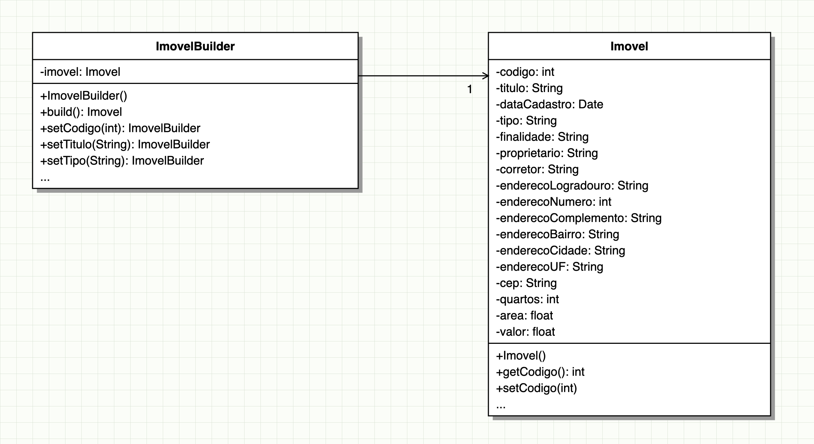

# Builder: Imóvel para Anúncio

Implementação do padrão de projeto **Builder**, aplicada ao cadastro de imóveis para anúncio.

## Diagrama UML



Versão editável em Mermaid: [docs/diagrama-uml.md](docs/diagrama-uml.md).

## Como rodar os testes

```
mvn test
```
